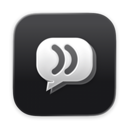
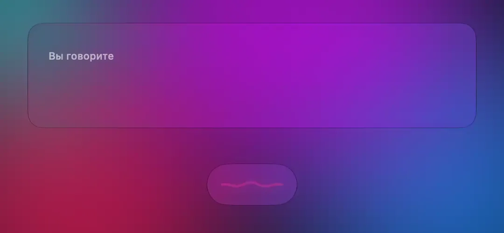
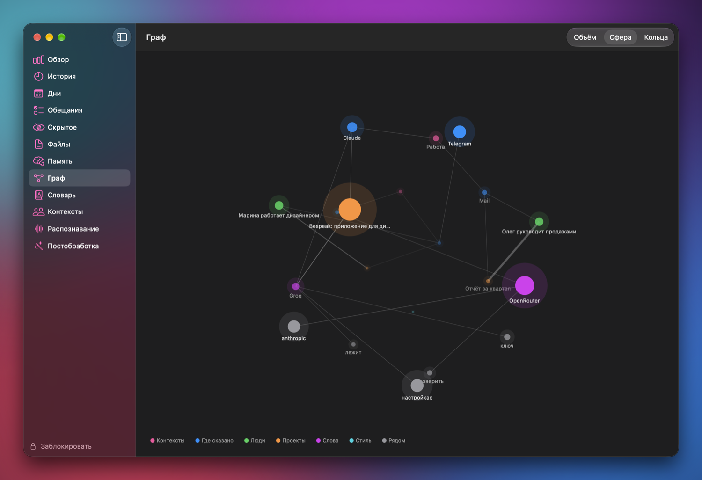
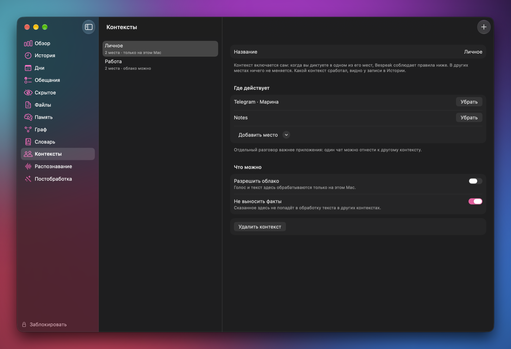
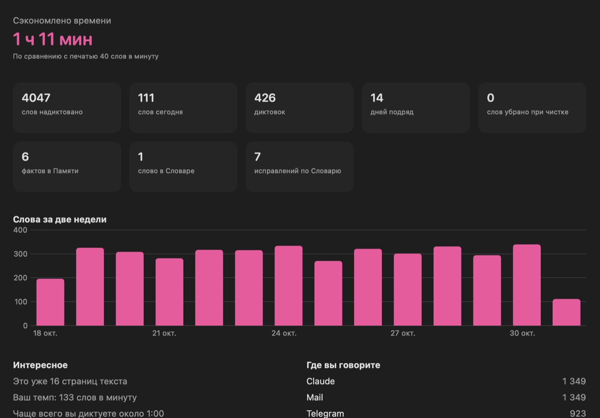

# Bespeak

### Говорите. Он напишет так, как написали бы вы.

Голосовой ввод для Mac, который работает на вашем компьютере, 
учится вашей речи и хранит сказанное зашифрованным.

&nbsp;

macOS 26 и новее · Apple silicon · бесплатно

 

Текст появляется, когда вы отпускаете клавишу. Jira и улыбка настраиваются в Словаре и Памяти

 

## Зачем он нужен

Говорить быстрее, чем печатать. Но обычная диктовка пишет сухо, путает термины, убирает вашу манеру и отправляет голос неизвестно куда.

Bespeak сделан иначе. Удерживайте **Fn**, говорите, отпустите, и текст появится там, где стоит курсор: в мессенджере, в письме, в заметках, в чате с нейросетью. Он создан для русской речи с английскими терминами и со временем пишет всё больше похоже на вас.

 

## Чем он лучше

| | Обычная диктовка | Bespeak |
|---|---|---|
| **Где работает** | Часто в облаке | На вашем Mac, облако только по вашему желанию |
| **Русский с английскими словами** | Путает термины | Jira, Groq и OpenRouter пишутся правильно |
| **Ваши слова** | Каждый раз заново | Исправили один раз, и он запомнил |
| **Смысл** | Заменяет слово механически | «Задача в джире» станет Jira, а «жир на теле» останется |
| **Паузы** | Каждый раз новое предложение | Понимает, что вы остановились на полуслове |
| **Манера** | Одна на всех | Своя в каждом приложении и с каждым человеком |
| **Личное** | Лежит открытым текстом | Зашифровано, окно закрыто по Touch ID |

 

## Что умеет

### 🎙 Диктовка в любом приложении
Удержание Fn или свободная запись с паузами. Индикатор появляется сразу, а сигнал «говорите» приходит, когда микрофон готов. Слова-паразиты убираются сами. Выделите текст и нажмите Fn + Return, и он вернётся чистым.

### 🧠 Учится вашей речи
Поправили слово прямо в сообщении, и Bespeak это заметил. Словарь узнаёт иностранные слова по звучанию и в любом падеже. Хранитель памяти сам разбирает диктовки и собирает факты о людях и проектах, а сомнительные оставляет на ваше подтверждение.

### 🙂 Пишет вашим голосом
Живые частицы остаются, канцелярит не проходит. С коллегами одно, с близкими другое. Скобка вместо смайлика тоже есть: Bespeak поставит её сам там, где вы хотите) Модели на вашем Mac подстраиваются слабее, облачные должны справляться лучше.

### 🕸 Граф знаний
Вся память на одной карте: люди, проекты, слова, приложения и контексты. Крутите в объёме, смотрите связи, переходите к записям. Три вида на выбор.

### 🗂 Контексты
Объедините приложения и отдельные чаты в «Работу», «Личное», «Лекции». Для личного можно запретить облако совсем, а факты оставить внутри, чтобы рассказанное близким не всплыло в рабочем письме.

### 📄 Файлы
Расшифровка записей встреч и перевод между русским и английским, с сохранением результата.

### 📊 Обзор
Сколько времени сэкономлено, сколько слов надиктовано, ваш темп, дни подряд и другие приятные цифры.

На снимках примерные данные

 

## Приватность

- **Локально по умолчанию.** Модели работают на вашем Mac.
- **Облако только с вашего согласия и с вашим ключом:** Groq для распознавания, OpenRouter, Anthropic, OpenAI или MiniMax для обработки. Провайдер получает только текст диктовки, если вы не разрешили больше.
- **Шифрование.** Диктовки, факты и расшифровки на диске зашифрованы.
- **Блокировка.** Записи открываются по Touch ID, паролю Mac или своему коду, а диктовка при этом продолжает работать.
- **Скрытые записи** с отдельной защитой и ключ восстановления.
- **Никакой телеметрии и аналитики.**

В сеть Bespeak выходит, только когда вы скачиваете модель, подключаете облачного провайдера или проверяете обновления.

 

## Установка

1. Скачайте `Bespeak-<версия>.dmg` на странице [Releases](https://github.com/and-ray-m/Bespeak.app/releases/latest) и перетащите Bespeak в «Программы».
2. Откройте его. macOS предупредит, что не может проверить приложение: оно пока не заверено Apple. Нажмите «Готово».
3. Откройте **Системные настройки → Конфиденциальность и безопасность**, пролистайте вниз и нажмите **«Всё равно открыть»**.
4. Выдайте доступ к микрофону и Универсальный доступ, затем выберите модель.

**Что нужно:** Mac с Apple silicon, macOS 26 или новее и место для моделей, от 300 МБ. Сверить образ можно по контрольной сумме из файла `.sha256`.

 

## Что нового

Вся история версий в [CHANGELOG.md](CHANGELOG.md).

 

### Если Bespeak вам полезен

[**Оставить чаевые**](https://pay.cloudtips.ru/p/587746f6)

